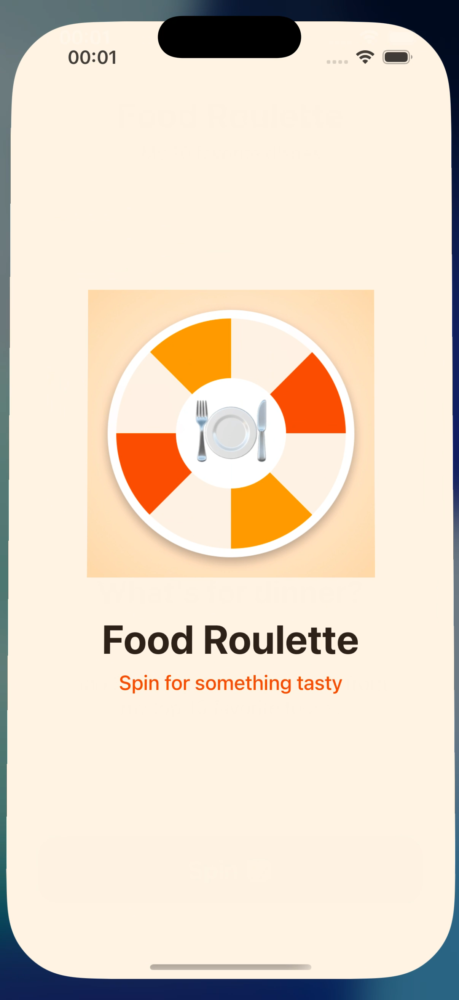
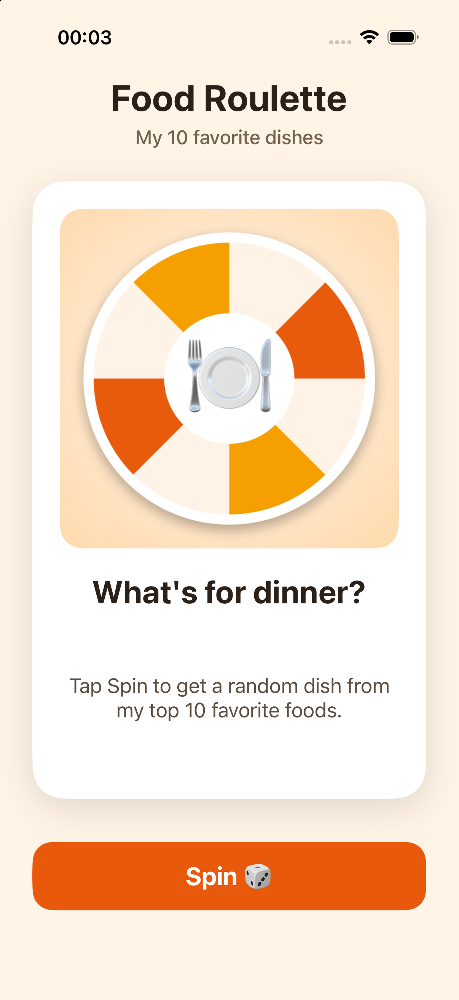
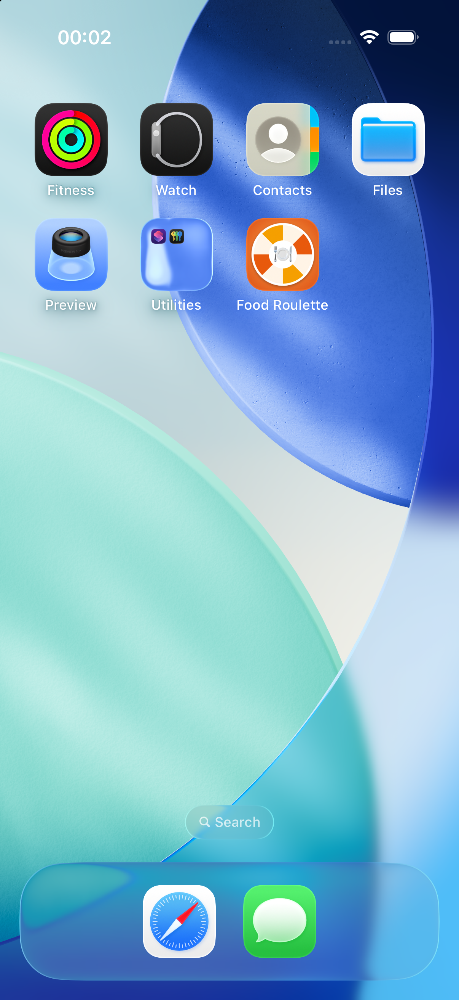

# Food Roulette

Lab 6 · Favorites Roulette — a single-screen iOS app that shows a random card from my 10 favorite dishes.

Each tap on **Spin** flips the card and shows a random dish: an image, a title and a short description.
The same dish never appears twice in a row.

## Screenshots

| Launch screen | Main screen | Home Screen |
|:---:|:---:|:---:|
|  |  |  |

## Category: Food

Beshbarmak · Plov · Manti · Baursak · Lagman · Shashlik · Pizza Margherita · Sushi · Smash Burger · Pancakes

## Project

- iOS App, Interface: Storyboard, Language: Swift
- Display Name: **Food Roulette**
- Layout in `Main.storyboard` with `UIImageView`, `UILabel` and `UIButton`, no Auto Layout constraints (frames + autoresizing masks)
- Custom `LaunchScreen.storyboard` (no constraints) and a custom 1024 × 1024 `AppIcon`
- Favorites are stored as an array of the `Favorite` struct (`Favorite.swift`), images live in `Assets.xcassets`
- No force unwraps except `@IBOutlet` declarations

## Run

Open `FavoritesRoulette.xcodeproj` in Xcode, pick an iPhone simulator and press ⌘R.
